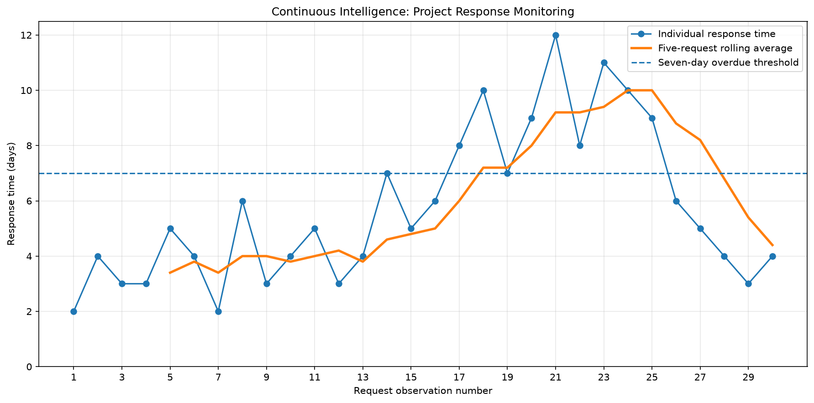

# Continuous Intelligence System Assessment

Continuous Intelligence | Project 06 | Example Report

## Overview

This project integrates signal design,
anomaly detection, and system assessment
into a continuous intelligence pipeline.

The objective is to transform operational measurements
into interpretable indicators of system behavior
and produce an overall assessment of system state.

## Data

The example dataset contains 60 observations
of system activity.

Each observation records:

- Requests handled.
- Errors encountered.
- Total response time in milliseconds.

The dataset includes a period of elevated
errors and response times.

[View Example Dataset](https://github.com/denisecase/cintel-06-continuous-intelligence/blob/main/data/system_metrics.csv)

## Methods

The pipeline applies three analytical steps.

### 1. Signal Design

Raw measurements are transformed into:

- Error rate: errors divided by requests.
- Average latency: total latency divided by requests.

### 2. Anomaly Detection

Individual observations are flagged when:

- Error rate exceeds 5%, or
- Average latency exceeds 30 milliseconds.

### 3. System Assessment

The pipeline calculates mean values
across all observations.

It classifies the overall system state as:

- `STABLE` when neither mean signal exceeds its threshold.
- `DEGRADED` when either mean signal exceeds its threshold.

## Results

The example produces the following assessment.

| Metric | Result |
|---|---:|
| Average requests | 157.35 |
| Average errors | 4.43 |
| Average error rate | 2.65% |
| Average latency | 33.71 ms |
| Overall system state | **DEGRADED** |

The pipeline also identifies **40 anomalous observations**
using its individual-observation thresholds.

[View System Assessment](https://github.com/bcookson85/cintel-06-project-intelligence/blob/main/artifacts/system_assessment.csv)

## Interpretation

The overall assessment is **DEGRADED** because the average
latency of 33.71 milliseconds exceeds the configured
threshold of 30 milliseconds.

The average error rate remains below its 5% threshold.

The pipeline also identifies **40 anomalous observations**
using its individual-observation thresholds.

This demonstrates how a system's assessment can change
when monitoring thresholds are adjusted, even when the
underlying observations remain unchanged.

The results emphasize the importance of selecting
appropriate thresholds and considering both aggregate
system behavior and individual anomalies.

## Limitations

The example assessment is based on aggregate
means and fixed thresholds.

It does not yet incorporate rolling-window analysis,
reference-period drift comparisons,
or persistent alerting.

The final assessment artifact contains summary metrics
but does not preserve the individual anomaly records.

A more complete system could retain
observation-level evidence and combine
rolling monitoring, drift detection,
and system-state classification.

## Conclusion

Continuous intelligence connects measurements,
signals, analytical rules, and interpretation.

The example demonstrates how several techniques
can contribute to an assessment of system behavior.

Its most important finding is that
**an overall stable classification does not guarantee
that every observation was within acceptable limits.**

Effective monitoring requires both summary assessments
and sufficient detail to investigate anomalous conditions.

---

## Custom Application: Integrated Project Performance Monitoring

### Problem and Objective

This custom application investigates how continuous intelligence techniques can be combined to monitor project request response times.

The objective is to identify overdue requests, detect changes in response-time performance, monitor rolling trends, and produce an overall project performance assessment.

Unlike the original system-metrics example, this application focuses on project responsiveness rather than system errors and processing latency.

### Data

The application uses a synthetic dataset of 30 project requests created for this project.

Each observation contains:

- A unique request ID.
- A project phase: Planning, Design, or Construction.
- The number of days required to respond.

The observations are arranged in sequence to demonstrate a period of increasing response times followed by improvement. Observation order is used because the dataset does not contain timestamps.

[View Custom Project Dataset](https://github.com/bcookson85/cintel-06-project-intelligence/blob/main/data/project_requests.csv)

### Methods and Techniques

The custom pipeline integrates five analytical techniques:

1. **Signal Design:** Flags requests taking more than seven days.
2. **Anomaly Detection:** Identifies individual requests exceeding the seven-day threshold.
3. **Rolling Monitoring:** Calculates five-request rolling averages and overdue percentages.
4. **Baseline Comparison and Drift Detection:** Compares the first 10 requests against the last 10 requests, using a two-day difference threshold.
5. **Integrated Assessment:** Classifies overall project responsiveness as STABLE or DEGRADED based on the detected drift.

The application is implemented using Python and Polars, with Matplotlib used to generate the visualization.

### Results

The application successfully processed all 30 project requests.

| Metric | Result |
|---|---:|
| Total observations | 30 |
| Requests exceeding seven days | 8 |
| Historical average response time | 3.60 days |
| Recent average response time | 7.20 days |
| Increase in average response time | 3.60 days |
| Drift detection threshold | 2.00 days |
| Drift detected | Yes |
| Recent overdue percentage | 50.00% |
| Overall assessment | **DEGRADED** |

### Project Response Monitoring Visualization

The following visualization displays individual response times, a five-request rolling average, and the seven-day overdue threshold.

The chart illustrates how response times increased substantially before beginning to decline toward the end of the observation sequence.

### Interpretation

The historical average response time was 3.60 days, compared with 7.20 days for the recent observation period.

This increase of 3.60 days exceeds the configured drift threshold of 2.00 days, resulting in a DEGRADED assessment.

Eight requests exceeded the seven-day overdue threshold, demonstrating that individual observations can present operational concerns in addition to the overall performance trend.

The rolling average helps reveal sustained changes that are less obvious when examining individual responses alone.

Although the final observations show improvement, the recent-period average remains significantly higher than the historical baseline.

### Limitations

The dataset is synthetic and does not represent actual business operations.

The observations do not include timestamps, so the application analyzes sequence order rather than calendar-based trends.

The overdue and drift thresholds are illustrative and would need to be validated against actual project requirements.

The anomaly detection method uses a fixed response-time threshold rather than a statistical outlier model.

Additionally, the assessment relies on a comparison of two fixed observation periods and does not independently evaluate changes in the middle observations.

### Future Improvements

If development continued, the application could be enhanced by:

- Incorporating real project request data with timestamps.
- Monitoring performance separately by project phase or contractor.
- Evaluating statistical anomaly detection methods.
- Comparing rolling windows against historical reference periods.
- Creating automated alerts when performance deteriorates.
- Developing an interactive dashboard for ongoing monitoring.

### Custom Application Files

- [Project Dataset](https://github.com/bcookson85/cintel-06-project-intelligence/blob/main/data/project_requests.csv)
- [Project Intelligence Application](https://github.com/bcookson85/cintel-06-project-intelligence/blob/main/src/cintel/project_intelligence.py)
- [Project Analysis Utilities](https://github.com/bcookson85/cintel-06-project-intelligence/blob/main/src/cintel/utils_project.py)
- [Visualization Script](https://github.com/bcookson85/cintel-06-project-intelligence/blob/main/src/cintel/visualize_project.py)
- [Detailed Monitoring Results](https://github.com/bcookson85/cintel-06-project-intelligence/blob/main/artifacts/project_signals.csv)
- [Integrated Project Assessment](https://github.com/bcookson85/cintel-06-project-intelligence/blob/main/artifacts/project_assessment.csv)

---

## Documentation Index

- **Home** - this landing page
- [**Project Instructions**](project-instructions.md)
- [**Glossary**](glossary.md)
- [**API**](api.md)
- [**Reactive App**](./app/index.html)

## Project Links

- [GitHub Repository](https://github.com/bcookson85/cintel-06-project-intelligence)
- [Example Pipeline](https://github.com/bcookson85/cintel-06-project-intelligence/blob/main/src/cintel/continuous_intelligence.py)
- [Results and Artifacts](https://github.com/bcookson85/cintel-06-project-intelligence/tree/main/artifacts)

## Project Resources

- [Project Instructions](project-instructions.md)
- [Professional Python Guide](https://denisecase.github.io/pro-analytics-02/)
- [Professional Python Project Explainer](https://pup-pack.github.io/professional-python-project-explainer/).
- [Suggested Datasets](https://denisecase.github.io/pro-analytics-02/reference/datasets/cintel/)
